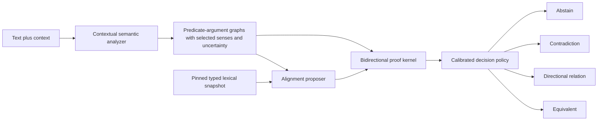

# Paraphrase Semantic Resolution Architecture

**Date:** 2026-08-03  
**Status:** Controlling direction  
**Decision:** Replace rule-accretion semantic resolution with contextual
analysis, bidirectional support checking, a small deterministic proof kernel,
and calibrated abstention.

## Decision

Paraphrase is not a bag of licensed surface rewrites. It is a claim that two
utterances preserve the same material predicate-argument content in both
directions under a stated context.

The system will therefore separate four responsibilities:



The authority path is deterministic end to end. The analyzer may enumerate
multiple explicit interpretations, but it cannot turn a confidence value into
a selected sense, referent, role, operator, or proof. A learned component may
remain as a diagnostic proposer only; every promoted semantic commitment must
be authenticated by exact source evidence and pinned deterministic resources.
The proof kernel is small. It checks the consequences of a selected analysis;
it does not contain a growing inventory of phrases, news constructions, or
benchmark-derived predicate pairs.

## Current implementation boundary

The code now separates the score-moving and authority-bearing lanes instead of
asking one rule registry to do both jobs:

1. The PSA neighborhood is a candidate router. Its score is recall-oriented
   and never means semantic equivalence.
2. `SymmetricEmbeddingRelationResolver` is the learned relation contract. It
   is structurally incapable of authorizing membership. The original hardened
   embedding-plus-graph ridge reached F1 `0.8322` and correctly failed its
   material-gain gate. A separately frozen 341-feature compact generic ridge
   reaches F1 `0.8564`, a paired gain of `+0.0224` over the authenticated
   historical classifier, with a 95% interval of `[+0.0087, +0.0362]`. Its
   fixed inputs are symmetric embedding summaries, PSA values, generic
   word/character overlap statistics, and generic graph overlap statistics;
   it contains no phrase or lemma exceptions. It remains a symmetric pair
   classifier, not yet the directional NLI system shown in the target
   architecture.
3. `proof_kernel_v1` contains only exact graph invariants and material-conflict
   checks. Clock B runs those semantics authoritatively on hydrated sentence
   pairs with complete evidence. The database independently normalizes the
   bound evidence, replays the sealed proof kernel, and requires the exact
   trace before hard membership can mutate.
4. New non-text membership remains disabled. Text membership is authorized
   only by exact text identity or `proof_kernel_equivalence`. Missing,
   partial, overflowed, or malformed logical-operator evidence forces a
   deterministic abstention instead of treating an empty list as proof of
   absence.
5. The old ETPC/MRPC patterns are available only through the explicit
   `legacy_etpc_mrpc_diagnostic_v1` benchmark policy. They are not selected by
   either service.
6. `semantic_proof.py` now implements the research architecture's first
   occurrence-bound proof contract. It deterministically validates selected
   concepts, typed roles, grounded referents, canonical literals,
   truth-commitment operators, pinned concept and alias licenses, directional
   support, and conflict witnesses. Its focused contract suite passes, but it
   is diagnostic-only and is not connected to a scorer or service. The frozen
   MRPC graph cache has no exact character spans, occurrence-bound sense
   records, grounded referent IDs, or complete operator stream, so zero cached
   sentences can instantiate this stricter contract as stored. See the
   [preregistered result](../audits/PARAPHRASE_DETERMINISTIC_SEMANTIC_PROOF_RESULT_2026-08-04.md).
7. `semantic_analysis.py` now implements the clean `semantic_analysis_v1`
   artifact and compilation gate. It stores exact character-bound token
   occurrences, occurrence-bound concept decisions and alternatives, typed
   arguments, grounded mention clusters, scoped operators, closed coverage
   claims, analyzer/tokenizer/resource content identities, and authenticated
   interpretation selection. The artifact has no dependency on the historical
   evidence, proposition-graph, rule-suite, score, membership, or persistence
   schemas. It either compiles a selected complete branch directly into the
   proof document or returns exact readiness failures. Canonical JSON
   round-trips preserve the artifact identity.
8. `semantic_evidence_compiler.py` now implements the first label-independent
   source-to-artifact compiler with occurrence-selected OEWN senses,
   sense-key-specific VerbNet roles, referent/coreference grounding, canonical
   literals, and complete finite operators. Its one-reveal MRPC run plus a
   post-reveal fail-closed coreference audit produced 22 proof-ready sentences
   but no pair with two ready endpoints, so all 1,725 pair outcomes correctly
   abstained. Semantic-role coverage, at 38 of 3,393 sentences, is the dominant
   gap. See the
   [preregistered compiler result](../audits/PARAPHRASE_MRPC_SEMANTIC_ANALYSIS_V1_RESULT_2026-08-04.md).

The compact resolver's binary score clears the diagnostic MRPC dashboard bar,
but its selective output does not: held-out likely-equivalent precision is
`0.9294` against a `0.95` calibration target. Consequently neither its binary
nor selective output has membership authority.

This is intentionally not described as a production migration. It is the
research architecture and evaluation boundary for the current codebase.

## Why this direction

Recent work supports a convergence of several ideas rather than a single
replacement model.

First, paraphrase is naturally modeled as mutual directional inference.
[Shi et al. (2024)](https://aclanthology.org/2024.starsem-1.11/) explicitly
formulate paraphrase identification through textual inference. This supplies
the core decision rule: equivalence requires support in both directions;
one-way support is entailment, not paraphrase.

Second, verification becomes more inspectable when claims are represented as
minimal predicate-argument relations. QASem parsing provides a broad
question-answer representation over predicate-argument structure
([Klein et al., 2022](https://aclanthology.org/2022.emnlp-main.528/)), and
[QASemConsistency (2026)](https://aclanthology.org/2026.tacl-1.6/) checks such
relations independently. Joint decomposition and verification can improve the
decomposition itself
([EACL Findings 2026](https://aclanthology.org/2026.findings-eacl.309/)). The
architecture should expose atomic support records without assuming that every
input must be decomposed identically.

That caveat matters: [MiniCheck (2024)](https://aclanthology.org/2024.emnlp-main.499/)
found that explicit decomposition is not always required for the best aggregate
fact-checking result. Decomposition is therefore an ablated component, not a
dogma or another fixed rule cascade.

Third, lexical evidence must be contextual and sense-level. Word Sense Linking
jointly identifies target spans and their senses rather than assuming the
correct target is already known
([Bejgu et al., 2024](https://aclanthology.org/2024.findings-acl.851/)).
[FOOL (2024)](https://aclanthology.org/2024.emnlp-main.290/) shows that WSD
systems remain vulnerable to adversarial lexical changes, while
[SenseRel (2026)](https://aclanthology.org/2026.acl-long.20/) emphasizes
relations between senses rather than relations between bare lemmas. This rules
out lemma-wide possible-sense unions as proof evidence.

Fourth, frame and graph representations help only when their limitations are
explicit. Contextual frame identification continues to improve
([EMNLP 2025](https://aclanthology.org/2025.emnlp-main.1499/)), and sense-aware
FrameNet information can support NLI
([ACL 2026](https://aclanthology.org/2026.acl-short.55/)). But existing AMR
metrics do not fully satisfy basic equivalence and inequivalence properties
([Opitz et al., 2024](https://aclanthology.org/2024.starsem-1.32/)). A shared
frame or a high graph score is candidate evidence, not identity by itself.

Finally, out-of-domain robustness and selective prediction must be first-class.
NLI fine-tuning gains can degrade out-of-domain behavior, and ordinary
synthetic examples may be too easy
([Stacey et al., 2026](https://aclanthology.org/2026.findings-eacl.286/)).
Selective NLI and duplicate-question work demonstrates the value of abstaining
when confidence is insufficient
([Varshney et al., 2022](https://aclanthology.org/2022.repl4nlp-1.23/),
[Kamath et al., 2022](https://aclanthology.org/2022.findings-acl.158/)). Risk
control should be measured as coverage changes, not hidden behind a single F1
number; risk-controlling prediction sets provide a general formal frame
([Bates et al., 2021](https://arxiv.org/abs/2101.02703)).

## Semantic representation

The analyzer emits a graph whose assertions distinguish observation,
hypothesis, and uncertainty. At minimum it represents:

- token spans and provenance;
- predicates and predicate occurrences;
- arguments, semantic roles, and entity mentions;
- polarity, modality, tense, aspect, scope, and attribution;
- quantities, comparators, dates, and temporal relations;
- clause and discourse relations;
- selected senses and frames with confidence;
- alternative analyses when the context does not select one; and
- explicit unresolved items.

An analyzer must never encode `all senses of this lemma` as though all were
observed. Candidate senses belong in a separate field and cannot enter strict
proof without contextual selection.

One possible contract is:

```text
SemanticAnalyzer.analyze(text, context) -> SemanticGraph
SemanticGraph = {
  assertions,
  operators,
  entities,
  selected_senses,
  candidate_senses,
  confidence,
  unresolved,
  provenance
}
```

## Alignment proposal

The proposer generates scored, directional candidates between graph elements.
It is the correct home for behaviors that the old verifier treated as rules:

- active/passive and other syntactic alternations;
- nominalization and derivation;
- converse predicates and role permutation;
- apposition and relative-clause alignment;
- clause decomposition and coordination;
- compound interpretation;
- pronoun and definite-description coreference;
- reporting and attribution attachment;
- event reification and light-predicate analysis; and
- contextual taxonomy or frame selection.

The proposer may use a cross-encoder, structured model, LLM, parser ensemble,
or a combination. Its output is evidence, not a verdict:

```text
AlignmentProposer.propose(left_graph, right_graph, lexical_snapshot)
  -> list[DirectionalAlignment]

DirectionalAlignment = {
  source_assertion,
  target_assertion,
  relation,
  role_map,
  selected_senses,
  score,
  evidence,
  unresolved
}
```

Sentence embeddings remain useful for bounded candidate retrieval. They do not
authorize semantic identity. Work such as
[ALIGN-SIM (2024)](https://aclanthology.org/2024.findings-emnlp.436/) shows why
a single similarity representation should not be assumed to preserve every
semantic distinction.

## Proof kernel

The proof kernel receives graphs and proposed alignments. It applies only
corpus-independent invariants:

1. Every material source assertion must have directional support in the
   target, or be explicitly marked unresolved.
2. Every material target assertion must have directional support in the
   source for equivalence.
3. Predicate roles and entity bindings must remain consistent.
4. Polarity, modality, scope, quantity, comparator, time, and attribution
   cannot disappear silently.
5. Directional ontology relations retain direction.
6. Conflicting selected senses cannot be repaired by lemma candidates.
7. Resource traversal is bounded, typed, and pinned.
8. Every accepted proof records analyzer, resource, alignment, kernel, and
   decision-policy provenance.

The kernel returns support and conflicts, not a binary label:

```text
ProofKernel.check(left_graph, right_graph, alignments) -> ProofResult
ProofResult = {
  left_supported,
  right_supported,
  conflicts,
  unresolved,
  evidence_provenance
}
```

Logical or theorem-proving machinery may be used inside this boundary, but
formalization itself must be checked. Autoformalization can lose source
semantics even when the resulting proof is valid
([ACL 2025](https://aclanthology.org/2025.acl-long.867/)). A valid proof of the
wrong formalization is not semantic verification.

## Decision policy

The decision policy maps a proof to four semantic outcomes:

| Left supports right | Right supports left | Material conflict | Outcome |
|---|---|---|---|
| yes | yes | no | equivalent |
| yes | no | no | left entails right |
| no | yes | no | right entails left |
| any | any | yes | contradiction or incompatible |
| uncertain | uncertain | no | abstain |

The existing three-state storage contract may initially map both directional
relations and unsupported cases to non-membership or satellites, but the proof
must retain the directional distinction. A calibrated policy chooses the
coverage at an explicitly measured error risk.

### Qualified-edge topology

`member_of` is the exclusive identity edge: a sentence admitted to the
invariant group core carries no qualified satellite edge for that revision.
A non-member may carry an ordered set of independently evidenced qualified
axes. For example:

- “Acme acquired Beta for $2 billion on Tuesday.” supports “Acme acquired
  Beta.”;
- the reverse direction does not support the amount or date; and
- the detailed sentence therefore preserves both `member_scale` and
  `member_temporal`, not one generic elaboration edge.

One-sided proposition-graph argument gaps are typed only from the graph's
closed semantic roles (`quantity`/`amount`/`value` and
`time`/`date`/`temporal`). This is schema-level evidence, not a surface phrase
or lemma rule. Any simultaneous untyped gap fails closed. Qualified edge sets
must hold against every current core member and commit in one graph
transaction. `proposed_contradiction` is also exclusive with the qualified
set.

Directional NLI may propose the same plural axis set for diagnostics and later
learned consumers, but it cannot write these relationships. Persistence still
requires the authenticated deterministic proof boundary until an independent,
calibrated admission contract is established.

### Deferred semantic-axis inventory

Edge axis and support direction are independent coordinates: a detailed
sentence can support a simpler sentence while carrying any subset of qualified
axes relative to that core member. `member_of` remains the exclusive case for
mutual equivalence with no material qualified axis.

- `member_spatial` is the next bounded generic axis. Proposition graphs already
  preserve material location gaps, but location is currently folded into
  `ROLE`; adding it requires a distinct atomic semantic axis and a new
  cache/schema identity.
- Modality must eventually be separated from aspect rather than hidden inside
  a broad predicate difference.
- Scope/quantification and attribution/evidentiality require explicit
  truth-commitment semantics before they can become qualified axes.
- Causal and conditional differences are claim-changing by default and remain
  fail-closed unless the proposition representation can prove the relevant
  relation.
- Referent or semantic-role substitutions and polarity reversals are identity
  protections or contradictions, not satellite axes.

These are schema capabilities, not a queue of phrase, lemma-pair, or corpus
exceptions. Each future axis needs independent evidence, calibration, versioned
artifacts, and plural-edge interaction tests before persistence authority.

## Pinned lexical snapshot

The lexical snapshot remains worthwhile, but only after the authority boundary
is enforced. Its artifact contract is:

- immutable schema and artifact version;
- complete content hash and upstream resource identities;
- directed `(hyponym_sense, hypernym_sense)` edges;
- typed synonym, antonym, and derivational sense relations;
- synset-level frame evocations only;
- a separate lemma-to-candidate-sense index;
- no lemma-level frame evidence in proof authority;
- deterministic sort and serialization;
- load once at verifier construction, not a live Neo4j query per decision; and
- artifact identity copied into every proof.

The lemma index supports candidate generation. It does not select a token's
sense. FrameBase `lex_unit` data that is first-writer-wins or sense-collapsed is
not valid licensing evidence; only the selected synset's frame relation may
enter a proof.

## Evaluation protocol

MRPC is retained as a historical development diagnostic, not a claim of
generality. Evaluation must use a sealed, sentence-disjoint protocol across
multiple phenomena and domains.

The MRPC dashboard reports three lanes separately:

| Lane | Question | Authority |
|---|---|---|
| Candidate router | Did the correct pair reach semantic resolution? | None |
| Learned relation resolver | Can a calibrated learned model classify the routed pair? | Diagnostic only |
| Proof kernel | How much complete evidence can the strict invariant checker prove or reject? | Hard membership only through the evidence-bound `core_proof_kernel_commit_v1` contract |

The admission-proof contract is now active for text evidence. A hard-membership
decision must carry a canonical proof hash in its immutable decision identity,
and the group revision must carry the full proof envelope. Database projection
independently checks the current strict profile, rule registry, decision policy,
pinned lexical resource, sealed `proof_kernel_v1` execution policy, endpoint
evidence hashes, positive proposition coverage, and empty conflict, blocked,
and unresolved sets before writing `member_of`. Factual-signature equality and
learned similarity remain nomination and routing metadata; neither can replace
this proof. A current proof bridge between two active groups authorizes one
atomic, canonical group convergence; the losing group is retired rather than
leaving duplicate semantic inventories active. Evidence drift on a
proof-backed member invalidates its old admission and quarantines that exact
revision unless the current evidence re-establishes authority.

Candidate-decision pages must share one validated comparison partition. The
database hydrates each typed endpoint once, applies the page in deterministic
event order to an in-memory bounded snapshot, and commits every final endpoint
projection through one all-or-nothing CAS with one bounded whole-page retry.
This preserves mirror/version semantics without paying one Neo4j transaction
per candidate decision.

F1 changes are comparable only within a lane under the same routing and split
contract. In particular, a classifier F1 must not be reported as a gain over a
high-precision proof kernel that intentionally abstains.

The frozen legacy verifier remains a historical comparator. A replay under a
new graph or evidence schema is a new result and must not be labeled exact
reproduction merely because it selects the legacy rule inventory.

The minimum report includes:

- bidirectional equivalence, directional entailment, contradiction, and
  abstention metrics;
- precision, recall, F1, and coverage at fixed risk points;
- calibration and risk-coverage curves;
- per-phenomenon results for negation, quantities, time, entities, scope,
  coreference, lexical sense, syntax, and discourse;
- cross-domain and out-of-distribution results;
- adversarial and metamorphic tests;
- analyzer, aligner, ontology, and kernel ablations; and
- a frozen error ledger that does not become a phrase-rule backlog.

[PARAPHRASUS (2025)](https://aclanthology.org/2025.coling-main.585/) reinforces
the need for multidimensional, multi-dataset evaluation: a single aggregate
dataset can conceal important tradeoffs.

## Rule promotion and rejection criteria

No phrase-shaped or corpus-derived condition enters the proof kernel. A
deterministic transformation may be promoted only when it is a universal
normalization or invariant with explicit counterexample analysis. Everything
else stays in the analyzer, proposer, ontology, or experimental package.

Automatically reject a proposed proof-kernel addition when its justification
is any of the following:

- “this fixes N MRPC false negatives”;
- a list of named lemma pairs;
- a market, news, custody, reporting, or other domain-specific construction;
- one or a few example-shaped conditionals;
- a shared frame without selected senses and direction checks; or
- a heuristic referent match without independent identity evidence.

## Clean implementation sequence

1. **Occurrence-bound proof kernel - complete.** Validate exact spans,
   selected concepts, roles, referents, literals, operators, typed licenses,
   bidirectional support, conflicts, and abstention without a score.
2. **`semantic_analysis_v1` artifact - complete.** Persist the full selected or
   alternative sentence interpretation with closed coverage claims and pinned
   analyzer, tokenizer, and resource identities. Refuse proof compilation when
   any required judgment is absent or ambiguous.
3. **Deterministic evidence compilers - initial v1 measured.** Exact
   tokenization, verbal predicate occurrence detection, conservative
   occurrence-level sense selection, direct sense-specific valence roles,
   referent/coreference grounding, canonical literals, and operator scope now
   compile directly into the v1 artifact. MRPC coverage proves the remaining
   work is clause-aware predicate inventory, joint sense/valence constraint
   solving, complete syntactic control and role realization, and independently
   grounded cross-document discourse identity. Continue to preserve
   alternatives instead of guessing.
4. **Pinned semantic resources.** Build the immutable sense, valence,
   entailment, converse, alias, and coreference evidence required by those
   compilers. Lemma candidates never become selected senses by adjacency.
5. **Proof-readiness and adversarial evaluation.** Measure analyzer coverage
   and semantic correctness per phenomenon. Run the proof kernel only on ready
   branches; unresolved cases remain abstentions.
6. **Consumer replacement.** If a live consumer is still wanted, make it read
   `semantic_analysis_v1` and the proof result directly. Do not add V2/V3
   adapters or dual-write compatibility paths.
7. **Old-path deletion.** Remove the historical evidence projection,
   proposition graph, rule suites, ledgers, learned resolver, compatibility
   branches, and experiment scripts as their actual consumers are removed.
   Frozen reports and Git history are sufficient historical evidence; old
   executable architecture is not a retention requirement.

The keep/rewrite/delete rule is semantic value, not age. Exact provenance,
operator categories, adversarial cases, and measured reports may be reused.
Legacy schemas, hidden scores, corpus-shaped rules, and compatibility machinery
are rewritten or deleted rather than carried into the new authority path.
